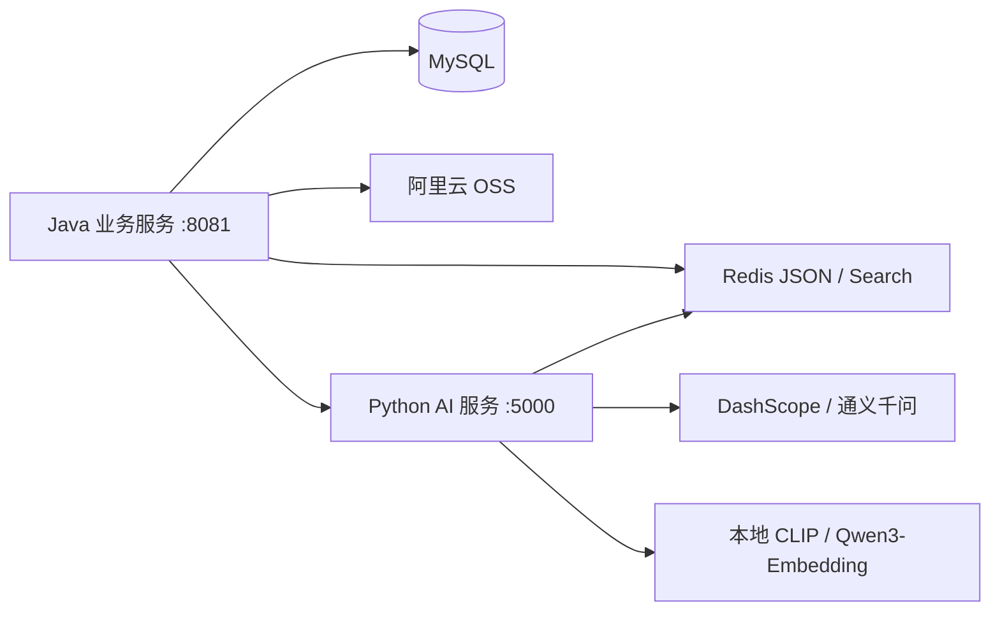

# AIWear 后端 · 智能穿搭与图片创作服务

AIWear（ClothChange）后端提供账号认证、图片素材管理、AI 图片编辑、双图合并与试衣、文字搜索、以图搜图和创作记录等接口。

后端由 Java 业务服务、Python AI 服务和中间件部署配置组成。Java 负责账号、权限、文件存储与创作记录，Python 负责图片校验、模型调用、特征提取和图片检索。

> 首次运行需要自行配置 MySQL、支持 RedisJSON 和 Redis Search 的 Redis、阿里云 OSS、DashScope API Key 及本地模型，具体准备步骤见下文。

## 功能

- **账号登录与注册**：支持邮箱验证码、用户名密码两种方式；不存在的账号在首次登录时创建。邮箱验证码有效期为 5 分钟，JWT 默认有效期为 12 小时。
- **个人素材库**：上传、查看和删除自己的图片。上传前检查文件真实格式、像素数量，并调用 AI 判断图片是否包含人物或服装。
- **AI 图片编辑**：选择一张素材，用文字描述需要修改的内容。
- **AI 试衣与合并**：按顺序选择人物与服装等两张素材，通过指令生成合并结果。
- **文字搜索与以图搜图**：仅检索当前用户已完成索引的素材，按相似度降序返回。
- **创作记录**：查看编辑和合并的输入图片、指令与生成结果，支持按类型筛选。

## 架构与技术栈



| 模块 | 主要技术 |
| --- | --- |
| Java 服务 | Java 17、Spring Boot 4.0.0、MyBatis-Plus 3.5.18、JJWT、BCrypt、阿里云 OSS SDK |
| Python 服务 | Flask、LangChain、LangGraph、DashScope、PyTorch、Transformers、Pillow、NumPy |
| 数据与存储 | MySQL；Redis 登录态、验证码与图片 JSON；OSS 图片对象 |
| 部署配置 | Docker Compose、MySQL 8.4.2、Redis 7.0.15 |

当前模型分工如下：

| 用途 | 模型 |
| --- | --- |
| 编辑任务 Agent、人物／服装判断 | `qwen-plus` |
| 图片内容描述 | `qwen3-vl-plus` |
| 图片编辑与合并 | `qwen-image-3.0` |
| 图片特征提取 | 本地 `clip-vit-base-patch16`，512 维向量 |
| 文字与图片描述的语义向量 | 本地 `Qwen/Qwen3-Embedding-0.6B` |

## 后端目录结构

```text
ClothChange/
├── README.md
├── AIWearJava/                      # Java 业务服务
│   ├── pom.xml
│   └── src/main/
│       ├── java/com/aiwear/         # Controller、Service、Mapper、DTO 等
│       └── resources/application.yml
├── AIWearPython/                    # Python AI 服务
│   ├── app.py                      # HTTP 接口与图片编辑 Agent
│   ├── image_store.py              # 图片处理、向量入库及检索
│   ├── edit_image/                 # 图片描述、校验和编辑工具
│   ├── download_model.py           # CLIP 模型下载脚本
│   └── requirements.txt
└── middleware-deploy/               # 中间件部署配置
    ├── compose.yaml
    ├── prepare.sh                  # 首次生成中间件凭据与 Redis 配置
    └── mysql/init/01-init.sql       # 库设置与权限，不创建业务表
```

## 环境要求

| 依赖 | 要求 |
| --- | --- |
| Java / Maven | JDK 17，Maven 3.x；仓库未提供 Maven Wrapper |
| Python | Python 3.12+；当前开发虚拟环境为 3.13，固定的 NumPy 版本要求至少 3.12 |
| MySQL | MySQL 8.x，准备 `bite_wear` 数据库及下文的三张业务表 |
| Redis | 需要 `JSON.GET`、`JSON.SET`、`FT.CREATE`、`FT.SEARCH` 命令及向量索引能力 |
| 云服务 | 可读写的 OSS Bucket；可调用上述通义千问模型的 DashScope API Key |
| 本地模型 | 已下载完整的 CLIP 和 Qwen3-Embedding 模型文件；有可用 CUDA 时自动使用 GPU，否则使用 CPU |

以下运行示例使用 **PowerShell**，每个服务使用独立终端。标为 Bash 的中间件命令在 Linux 上执行。各步骤的 `cd` 命令均从项目根目录开始。

## 本地运行

### 1. 准备 MySQL 与 Redis

可以接入已有实例，也可以使用 [middleware-deploy](./middleware-deploy/README.md) 中的 Compose 配置准备基础中间件。在已安装 Docker、Compose 插件和 OpenSSL 的 Linux 服务器上执行：

```bash
cd middleware-deploy
bash prepare.sh
docker compose -p bite_wear config --quiet
docker compose -p bite_wear up -d bite_wear-mysql bite_wear-redis
docker compose -p bite_wear ps
```

`prepare.sh` 仅用于首次初始化，生成 `.env` 和 Redis 配置，并拒绝覆盖已有文件。MySQL 应用用户为 `bite`，数据库名为 `bite_wear`，密码从生成的 `.env` 获取。Docker 命名卷保存 MySQL 和 Redis 数据。

上述命令只启动后端所需的 MySQL、Redis 中间件，Java 和 Python 服务需按后续步骤分别启动。

**Redis 模块需要单独处理**：当前 Compose 使用普通 `redis:7.0.15`。该实例可以保存登录态和验证码，但不支持图片 JSON 入库和检索；完整运行前需接入已启用 RedisJSON 与 Redis Search 的实例，并同步 Java、Python 的连接设置。仅有 `PING` 成功不足以说明图片检索可用。

Compose 将数据库端口绑定到服务器本机的 `3306`、`6379`，而当前应用配置默认连接本机的 `13306`、`16379`。从开发机连接远程中间件时，可使用 SSH 转发并保持终端运行：

```powershell
ssh -N -L 13306:127.0.0.1:3306 -L 16379:127.0.0.1:6379 '<服务器用户>@<服务器地址>'
```

如果直接使用本机 `3306`、`6379`，相应调整后续的 `MYSQL_PORT`、`REDIS_PORT`。若检索 Redis 使用其他端口，按实际部署修改转发目标。

### 2. 初始化业务表

应用没有自动建表或数据库迁移逻辑。`middleware-deploy/mysql/init/01-init.sql` 只调整数据库设置与权限，**不会创建 `users`、`files`、`records`**。

以下是依据当前 Java 实体字段整理的最小开发库参考结构，可在全新的开发库中执行。已有数据库应先核对结构；`CREATE TABLE IF NOT EXISTS` 不会修正已有表的字段差异。这不是从现有数据库导出的正式迁移脚本。

```sql
CREATE DATABASE IF NOT EXISTS bite_wear
  CHARACTER SET utf8mb4 COLLATE utf8mb4_unicode_ci;
USE bite_wear;

CREATE TABLE IF NOT EXISTS users (
  id BIGINT NOT NULL AUTO_INCREMENT,
  username VARCHAR(255) NOT NULL,
  password_hash VARCHAR(255) NULL,
  email VARCHAR(255) NULL,
  PRIMARY KEY (id),
  UNIQUE KEY uk_users_username (username)
) ENGINE=InnoDB DEFAULT CHARSET=utf8mb4;

CREATE TABLE IF NOT EXISTS files (
  id BIGINT NOT NULL AUTO_INCREMENT,
  user_id BIGINT NOT NULL,
  file_name VARCHAR(255) NOT NULL,
  file_size BIGINT NOT NULL,
  oss_url VARCHAR(2048) NOT NULL,
  PRIMARY KEY (id),
  KEY idx_files_user_id (user_id)
) ENGINE=InnoDB DEFAULT CHARSET=utf8mb4;

CREATE TABLE IF NOT EXISTS records (
  id BIGINT NOT NULL AUTO_INCREMENT,
  user_id BIGINT NOT NULL,
  action VARCHAR(16) NOT NULL,
  instruction VARCHAR(1000) NOT NULL,
  input_oss_url1 TEXT NOT NULL,
  input_oss_url2 TEXT NULL,
  output_oss_url TEXT NOT NULL,
  result_url TEXT NULL,
  PRIMARY KEY (id),
  KEY idx_records_user_id (user_id)
) ENGINE=InnoDB DEFAULT CHARSET=utf8mb4;
```

邮箱验证码注册时不设置密码，因此 `password_hash` 允许为空；用户名密码注册时不要求邮箱，因此 `email` 允许为空。表名和字段名需与 MyBatis-Plus 实体映射一致。

### 3. 准备 Java 本地配置

主配置位于 [AIWearJava/src/main/resources/application.yml](./AIWearJava/src/main/resources/application.yml)。其中包含数据库账号、邮件、JWT 和 OSS 等与环境有关的固定配置，运行前需要替换。

推荐新建 `AIWearJava/src/main/resources/application-local.yml`，使用以下覆盖示例，再通过 `SPRING_PROFILES_ACTIVE=local` 启用。**此文件当前未提供，需要自行创建**；示例通过环境变量读取凭据：

```yaml
spring:
  datasource:
    username: ${MYSQL_USERNAME:bite}
    password: ${MYSQL_PASSWORD}
  mail:
    username: ${SMTP_USERNAME:}
    password: ${SMTP_PASSWORD:}

jwt:
  secret: ${JWT_SECRET}

aliyun:
  oss:
    endpoint: ${ALIYUN_OSS_ENDPOINT:oss-cn-beijing.aliyuncs.com}
    access-key-id: ${ALIYUN_OSS_ACCESS_KEY_ID}
    access-key-secret: ${ALIYUN_OSS_ACCESS_KEY_SECRET}
    bucket-name: ${ALIYUN_OSS_BUCKET_NAME}
```

上述变量由这个本地覆盖示例解析，不能在未创建文件时假定所有变量都已被原配置引用。也可以直接修改主配置中的对应项，但不要提交真实密码、AccessKey 或 API Key。

- OSS `endpoint` 只填地域主机名，例如 `oss-cn-beijing.aliyuncs.com`，不带协议、Bucket 或路径；Bucket 与地域须对应。
- OSS 身份需要读取原图、上传结果及补偿删除对象的权限。Python 的 `OSS_TRUSTED_HOSTS` 必须与最终的 Bucket 域名一致。
- 原邮件配置使用 QQ SMTP。需要邮箱验证码登录时设置发件邮箱和 SMTP 授权码；使用其他邮件服务时同时调整 `spring.mail` 的主机、端口和 TLS 配置。
- JWT 使用 HS256，`JWT_SECRET` 至少需要 32 字节。`jwt.expiration` 当前为 `12`，单位为小时。

### 4. 安装 Python 依赖并下载模型

```powershell
cd AIWearPython
python -m venv .venv
.\.venv\Scripts\python.exe -m pip install -r requirements.txt
```

Linux / macOS 对应使用 `python3 -m venv .venv`，并将后续的 `.\.venv\Scripts\python.exe` 替换为 `.venv/bin/python`。已有虚拟环境可直接使用，无需重复创建。

CLIP 模型下载脚本依赖 `modelscope`，该下载工具未列入 `requirements.txt`，首次使用需额外安装：

```powershell
.\.venv\Scripts\python.exe -m pip install modelscope
.\.venv\Scripts\python.exe download_model.py
```

脚本下载 `openai-mirror/clip-vit-base-patch16` 并打印模型目录。将输出的实际目录用于 `CLIP_MODEL_PATH`；代码中的默认值是开发者机器上的绝对路径，换机器后需要覆盖。

Qwen3-Embedding 也需要提前下载。以下示例保存到 Python 模块下的 `models` 目录：

```powershell
$env:TEXT_EMBEDDING_MODEL_PATH = Join-Path $PWD 'models\Qwen3-Embedding-0.6B'
.\.venv\Scripts\python.exe -c "import os; from huggingface_hub import snapshot_download; snapshot_download('Qwen/Qwen3-Embedding-0.6B', local_dir=os.environ['TEXT_EMBEDDING_MODEL_PATH'])"
```

两个本地模型在运行时均以 `local_files_only=True` 加载，不会在首次请求时自动联网补齐文件。首次下载模型需要网络和足够的磁盘空间。

### 5. 启动 Python 服务

在 `AIWearPython` 目录的终端设置：

```powershell
$env:DASHSCOPE_API_KEY = '<你的 DashScope API Key>'
$env:CLIP_MODEL_PATH = '<下载脚本打印的 CLIP 完整目录>'
$env:TEXT_EMBEDDING_MODEL_PATH = Join-Path $PWD 'models\Qwen3-Embedding-0.6B'
$env:OSS_TRUSTED_HOSTS = '<你的Bucket>.oss-cn-beijing.aliyuncs.com'
$env:REDIS_HOST = '127.0.0.1'
$env:REDIS_PORT = '16379'
$env:REDIS_PASSWORD = '<Redis 密码；未设置密码时使用空字符串>'
$env:REDIS_DB = '0'
.\.venv\Scripts\python.exe app.py
```

服务固定监听 `127.0.0.1:5000`，启动时尝试创建图片索引 `idx:aiwear:images`。需要调整监听地址或端口时，修改 `app.py` 底部的启动配置，并同步 Java 的 Python 服务地址。

Python 还支持以下配置：

| 环境变量 | 默认值与用途 |
| --- | --- |
| `OSS_TRUSTED_HOSTS` | 默认 `ai-wear666.oss-cn-beijing.aliyuncs.com`；允许下载的 OSS 域名，多个域名用逗号分隔，不带协议和路径 |
| `IMAGE_MAX_PIXELS` | 默认 `25000000`，限制图片解码像素数，建议与 Java 的 `aliyun.oss.max-pixels` 一致 |
| `TEXT_EMBEDDING_MODEL_PATH` | 默认 `Qwen/Qwen3-Embedding-0.6B`；可以是已有本地目录或已完整缓存的模型 ID |

Redis 索引初始化失败会记录日志，HTTP 服务仍可能启动。因此看到 Flask 启动信息后，还需确认日志中没有 Redis 模块、认证或索引错误。

### 6. 启动 Java 服务

在新终端中，从项目根目录执行。以下示例使用第 3 步的 `application-local.yml`：

```powershell
cd AIWearJava
$env:SPRING_PROFILES_ACTIVE = 'local'
$env:MYSQL_HOST = '127.0.0.1'
$env:MYSQL_PORT = '13306'
$env:MYSQL_USERNAME = 'bite'
$env:MYSQL_PASSWORD = '<MySQL 应用用户密码>'
$env:REDIS_HOST = '127.0.0.1'
$env:REDIS_PORT = '16379'
$env:REDIS_PASSWORD = '<与 Python 一致的 Redis 密码>'
$env:JWT_SECRET = '<至少 32 字节的随机字符串>'
$env:ALIYUN_OSS_ACCESS_KEY_ID = '<你的 AccessKey ID>'
$env:ALIYUN_OSS_ACCESS_KEY_SECRET = '<你的 AccessKey Secret>'
$env:ALIYUN_OSS_BUCKET_NAME = '<你的 Bucket 名称>'
$env:PYTHON_SERVICE_BASE_URL = 'http://127.0.0.1:5000'
$env:PYTHON_SERVICE_SIGN_OSS_URL = 'true'

# 如需使用邮箱验证码登录，再配置以下两项。
$env:SMTP_USERNAME = '<发件邮箱>'
$env:SMTP_PASSWORD = '<SMTP 授权码>'

mvn org.springframework.boot:spring-boot-maven-plugin:4.0.0:run
```

也可以在 IDE 中使用相同的环境变量运行 `com.aiwear.AIWearApplication`。Java 默认监听 `8081`。当前 POM 未显式声明 Spring Boot Maven 插件，上述命令使用完整插件坐标；普通 `mvn package` 产物不能直接当作已配置好的可执行 Spring Boot JAR。

Java 与 Python 必须连接同一套检索数据对应的 Redis；当前 Java 使用 Redis 数据库 `0`，Python 的 `REDIS_DB` 也应设为 `0`。环境变量只对当前终端及其子进程生效，新开终端时需要重新设置。

`PYTHON_SERVICE_SIGN_OSS_URL` 默认是 `false`。私有 Bucket 应设为 `true`，Java 会为图片入库生成临时签名地址；数据库及上传响应仍保存稳定 OSS 地址。私有对象的稳定地址需要额外读取授权，直接访问可能返回 403；如需提供下载能力，需要另行实现受认证的签名读取接口。

## Java API

Java 服务默认地址为 `http://127.0.0.1:8081`，业务接口统一以 `/api` 为前缀。除发送验证码和登录外，以下接口均需携带：

```http
Authorization: Bearer <登录返回的 token>
```

登录成功后取得 Token；图片业务会验证 JWT、Redis 中的有效 Token 和素材归属。

| 功能 | 方法与路径 | 请求参数 |
| --- | --- | --- |
| 发送邮箱验证码 | `POST /api/user/sendEmailCode` | JSON：`email` |
| 登录／首次注册 | `POST /api/user/login` | JSON：`account`、`verificationCode`，或 `account`、`password` |
| 退出登录 | `POST /api/user/logout` | 无请求体 |
| 上传图片 | `POST /api/file/upload/image` | multipart：`file` |
| 个人素材列表 | `POST /api/file/my/images` | 无请求体 |
| 删除素材 | `DELETE /api/file/delete/image` | 查询参数：`fileId` |
| 搜索素材 | `POST /api/file/search` | 文本搜索传表单 `query`；图片搜索传 multipart `file`，二选一 |
| 搜索兼容路径 | `POST /api/file/search/image` | 与 `/api/file/search` 相同 |
| 单图编辑 | `POST /api/file/edit_image` | JSON：`imageOssUrl`、`instruction` |
| 双图合并／试衣 | `POST /api/file/merge_images` | JSON：`image1Url`、`image2Url`、`instruction` |
| 创作记录 | `GET /api/file/my_record` | 可选查询参数：`action=edit` 或 `action=merge` |

编辑和合并的 `instruction` 最多为 1000 个字符，输入图片 URL 必须对应当前用户的素材。合并时两张图片的顺序与 `image1Url`、`image2Url` 一致，具体合并方式由指令决定。

Java 的业务响应使用 **`msg`** 字段：

```json
{
  "code": 200,
  "msg": "图片上传成功",
  "data": {
    "url": "https://<bucket>.<endpoint>/images/<date>/<uuid>.png",
    "fileName": "photo.png",
    "fileSize": 102400
  }
}
```

业务失败可能仍以 HTTP 200 返回，调用方需要检查 JSON 中的 `code`。登录成功的 `data` 包含 `token`、`userId`、`username`、`email`；编辑或合并成功的 `data` 包含模型结果地址 `url` 和已转存 OSS 的地址 `saveUrl`。

## Python 内部 API

Python 服务默认地址为 `http://127.0.0.1:5000`。以下接口供 Java 内部调用，响应格式随用途不同：

| 方法与路径 | 输入与用途 |
| --- | --- |
| `POST /app/validate_image` | multipart `image`；校验人物或服装内容 |
| `POST /app/skills` | multipart `instruction`、`image1`、可选 `image2`；调用编辑 Agent |
| `POST /api/upload-image` | JSON `ossUrl`、`userId`；生成描述及向量并入库 |
| `POST /api/delete-image` | JSON `ossUrl`、`userId`；清理图片检索缓存 |
| `POST /api/search-image` | multipart `userId`，以及 `query` 或 `file`；检索当前用户图片 |

## 数据流程与当前边界

### 图片上传

1. Java 验证 JWT、Redis 登录态、文件后缀、真实内容及像素数量。
2. Python 调用视觉模型描述图片，再判断是否包含人物或服装；通过后 Java 才上传 OSS。
3. Java 在短事务中保存 `files` 记录；数据库保存或提交失败时尝试删除本次 OSS 对象。
4. 数据库提交后，Java **同步等待** Python 下载 OSS 图片、生成描述、CLIP 图片向量和文字描述向量，并保存到 RedisJSON。

通过 Java 上传的素材仅支持 **JPG、JPEG、PNG**，单张最多 **10 MiB（10,485,760 字节）**，默认最多 **2500 万像素**。Spring 的 multipart 单文件／总请求限制分别为 `10MB`／`11MB`。Python 的图片处理也限制单张 10 MiB。

### 搜索与创作结果

- 文本搜索比较查询文本与图片描述的 Qwen3-Embedding 向量，相似度需 **大于 0.5**；以图搜图使用 CLIP 向量，相似度需 **大于 0.7**。
- 当前实现通过 Redis Search 按用户读取候选图片，在 Python 中逐张计算余弦相似度。
- 更换 `TEXT_EMBEDDING_MODEL_PATH` 后，原记录的模型标识可能不再匹配；项目没有自动重建全部素材索引的管理入口。
- 编辑／合并只允许使用当前用户素材库中的图片。成功后，结果保存至 OSS，输入、指令与结果地址写入 `records`；生成结果不会自动加入 `files` 或检索库。
- 删除素材会删除 `files` 记录及 Redis 检索数据，**当前不会删除 OSS 对象，也不会删除创作历史**。
- Python 编辑临时文件在任务成功后清理；失败时保留在 `AIWearPython/edit_image` 中，便于排查。

## 检查与排错

当前工作区没有可直接执行的 Java 回归脚本或 Python 自动化测试文件。真实数据库、OSS、SMTP 和模型调用仍需在配置完整的环境中联调。

| 现象 | 检查方向 |
| --- | --- |
| 登录或素材接口连接失败 | 确认 Java 已启动并监听 `8081`，检查调用地址、端口及 Java 服务日志 |
| 提示数据库表不存在 | 确认连接的是 `bite_wear`，并已创建 `users`、`files`、`records`；Compose 初始化不会创建业务表 |
| Redis 提示 `unknown command` | 确认实例支持 RedisJSON、Redis Search，而不是只有基础 Redis 命令 |
| 上传接口长时间未返回 | 上传包含云端校验和同步索引；Java 调用 Python 的连接／读取超时默认均为 `0s`，即不限制等待。检查 Java 和 Python 日志，并查询素材列表或 `files` 表确认是否已经保存 |
| 图片编辑或合并失败 | 检查输入素材归属、Java 与 Python 的连通性，以及模型调用、图片下载和 OSS 保存阶段的日志 |
| 上传成功但搜索不到 | 检查索引处理日志、本地模型路径、Redis 模块、OSS 白名单及下载权限；图片也可能没有达到相似度阈值 |
| 图片地址返回 403 | 检查 Bucket 读取权限。入库签名开关只解决 Python 下载，返回的稳定 URL 的读取授权需另行处理 |
| 本地模型加载失败 | 确认目录包含完整模型、处理器／分词器文件；当前加载方式不会自动下载缺失文件 |
| 邮箱验证码无法发送 | 检查 SMTP 发件邮箱、授权码、主机和端口；同一邮箱已有未过期验证码时会拒绝重复发送 |
| 请求返回 HTTP 200 但业务失败 | 查看 JSON 中的业务 `code` 和 `msg`，不要仅以 HTTP 状态判断成功 |

补充文档：[中间件部署说明](./middleware-deploy/README.md)。局部旧文档中的部分接口、上传限额和测试入口与当前代码存在差异；本文按当前工作区的后端接口与配置整理。
